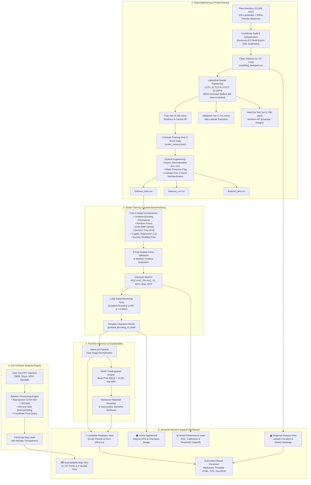
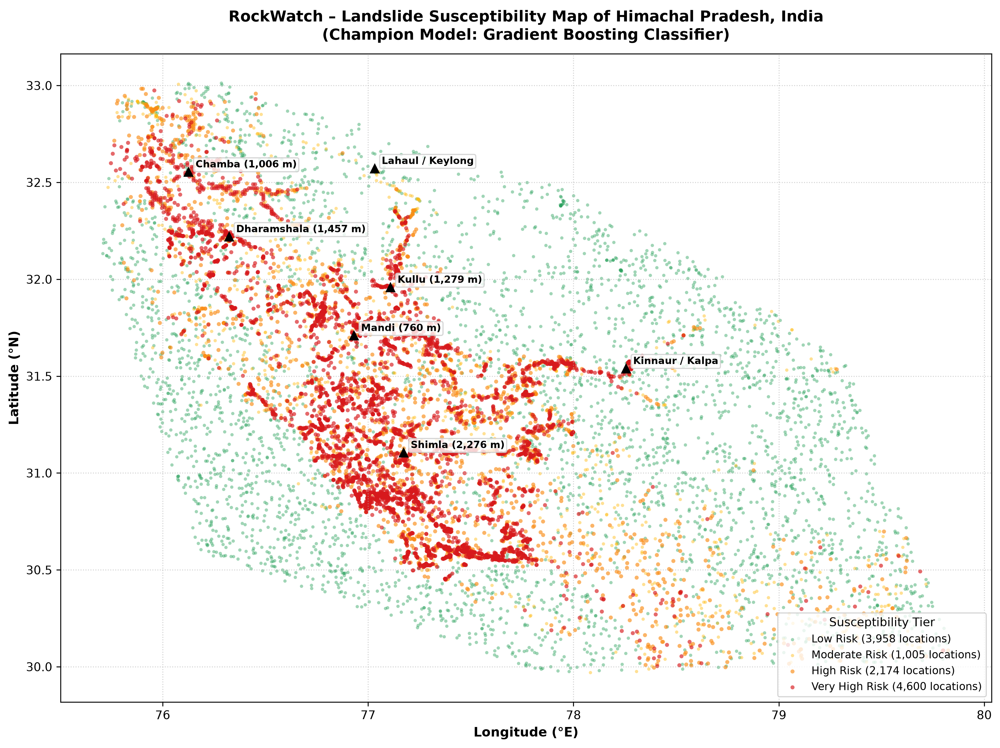
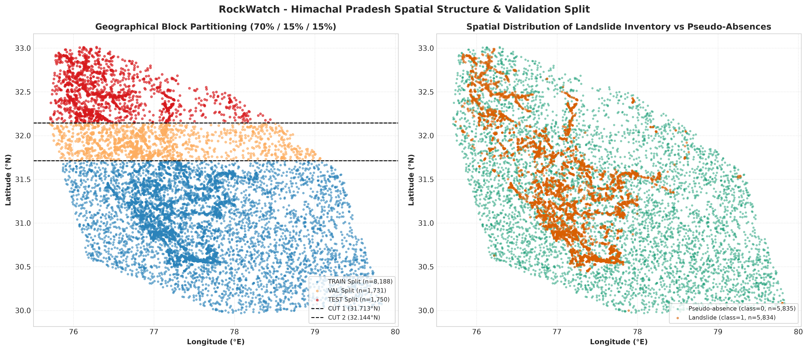
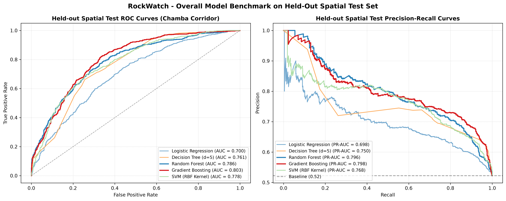
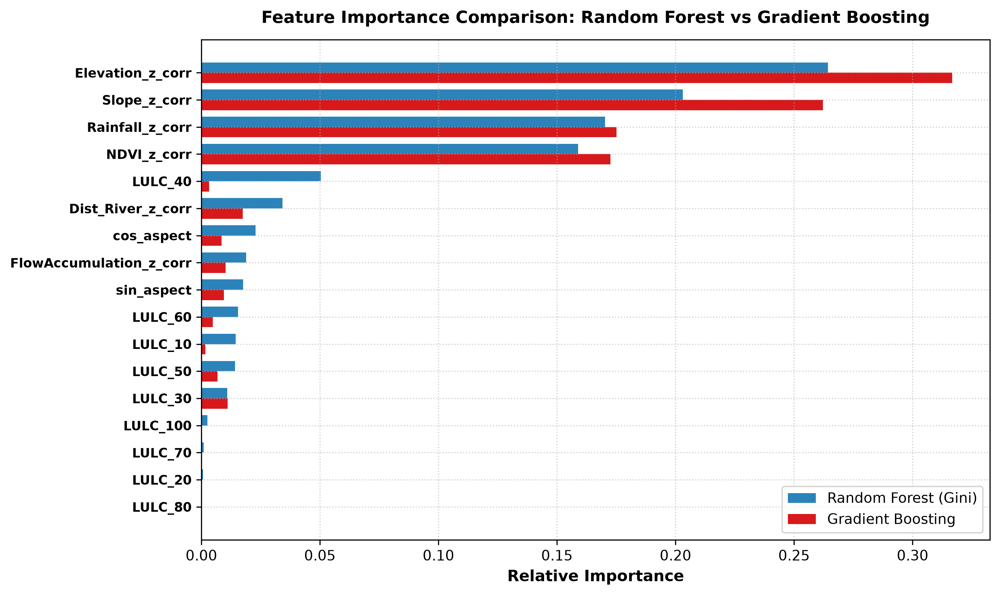
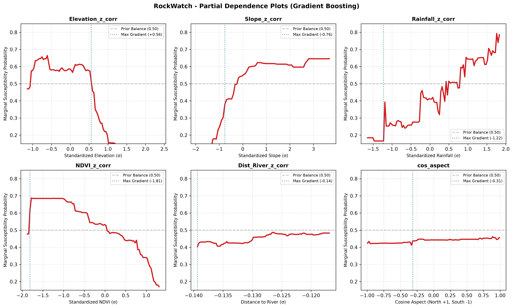
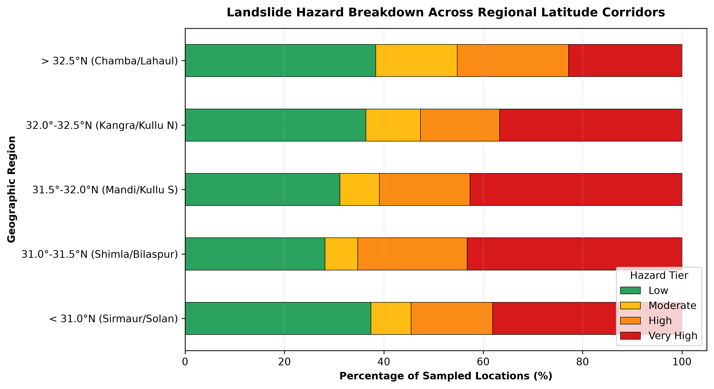

# RockWatch – Intelligent Landslide Susceptibility Prediction System

[](https://www.python.org/)
[](https://streamlit.io/)
[](https://scikit-learn.org/)
[](https://plotly.com/)
[](https://github.com/slundberg/shap)
[](https://rasterio.readthedocs.io/)
[]()
[](LICENSE)
[]()

> **RockWatch** is an end-to-end, scientifically validated machine learning and geospatial intelligence system for **landslide susceptibility assessment** across the mountainous terrain of **Himachal Pradesh, Western Himalayas, India**. Built with strict spatial block validation to eliminate spatial data leakage, RockWatch pairs high-accuracy ensemble classifiers with local explainable AI (SHAP), cloud-native GeoTIFF raster analysis, and an interactive, decision-support Streamlit web application.

---

## Table of Contents

1. [Executive Summary & Problem Statement](#1-executive-summary--problem-statement)
2. [Objectives & Key Capabilities](#2-objectives--key-capabilities)
3. [System Architecture & Workflow](#3-system-architecture--workflow)
4. [Application Screenshot Gallery](#4-application-screenshot-gallery)
5. [Technology Stack](#5-technology-stack)
6. [Study Area & Dataset Lineage](#6-study-area--dataset-lineage)
7. [Data Preprocessing & Leakage-Free Feature Engineering](#7-data-preprocessing--leakage-free-feature-engineering)
8. [Spatial Validation Methodology](#8-spatial-validation-methodology)
9. [Machine Learning Model Benchmark & Comparison](#9-machine-learning-model-benchmark--comparison)
10. [Champion Model Performance (Gradient Boosting)](#10-champion-model-performance-gradient-boosting)
11. [Explainable AI (Local SHAP Attribution Engine)](#11-explainable-ai-local-shap-attribution-engine)
12. [Interactive Susceptibility Mapping Module](#12-interactive-susceptibility-mapping-module)
13. [GeoTIFF Raster Analysis Engine](#13-geotiff-raster-analysis-engine)
14. [Automated Assessment Report Generation & Export](#14-automated-assessment-report-generation--export)
15. [Streamlit Application Architecture & Views](#15-streamlit-application-architecture--views)
16. [Repository Directory Structure](#16-repository-directory-structure)
17. [Installation & Setup Guide](#17-installation--setup-guide)
18. [Application Execution](#18-application-execution)
19. [Test Suite & Verification](#19-test-suite--verification)
20. [Operational Decision Policies for Disaster Management](#20-operational-decision-policies-for-disaster-management)
21. [Scientific Limitations & Caveats](#21-scientific-limitations--caveats)
22. [Responsible Use Disclaimer](#22-responsible-use-disclaimer)
23. [Future Roadmap](#23-future-roadmap)
24. [Citation, Authors & License](#24-citation-authors--license)

---

## 1. Executive Summary & Problem Statement

Landslides represent an acute, recurring existential threat throughout the Western Himalayan state of **Himachal Pradesh, India**. Characterized by steep structural escarpments, active seismotectonic shearing along the Main Central Thrust (MCT) and Main Boundary Thrust (MBT), intense monsoon precipitation, and accelerated anthropogenic infrastructure expansion, the region suffers frequent loss of life, severance of strategic national highway arteries (such as NH-05 and NH-21), and catastrophic destruction of hydroelectric installations and settlements.

### The Susceptibility vs. Hazard Distinction
A vital scientific distinction must be drawn between **static susceptibility** and **dynamic real-time forecasting**:
- **Landslide Susceptibility (RockWatch Core):** Quantifies the *relative, spatially stationary spatial propensity* of a terrain unit to generate slope failures based on inherent conditioning geo-environmental parameters (topography, drainage hydrology, land-use, vegetation, and multi-year climatological rainfall).
- **Landslide Hazard / Early Warning:** Requires incorporating dynamic, high-frequency temporal triggers (such as real-time rain-gauge telemetry, antecedent soil saturation indexes, and earthquake shaking).

RockWatch delivers a **macro-zonation screening intelligence system** engineered specifically to support civil protection planners, highway engineers, and disaster management authorities in spatial risk planning, pre-monsoon resource allocation, and preliminary infrastructure corridor assessment.

```
+----------------------------------------------------------------------------------------------------+
|                                    ROCKWATCH SYSTEM HIGHLIGHTS                                     |
+----------------------------------------------------------------------------------------------------+
| • Zero Data Leakage Pipeline : Strict train-only Z-score re-standardization and coordinate audit    |
| • Spatial Block Partitioning  : 500m latitudinal exclusion buffers separating Train, Val, and Test |
| • Champion Classifier         : Gradient Boosting (Test ROC-AUC: 0.8035, Test F1: 0.7368 at T=0.37)  |
| • Statistical Superiority     : Certified via 1,000 paired bootstrap resamples (p < 0.0001)        |
| • Local Explainability (XAI)  : SHAP TreeExplainer waterfall plots and geomorphic narrative engine |
| • Geospatial Raster Engine    : Rasterio-based GeoTIFF ingestion, UTM 43N reprojection & inspection|
| • Assessment Deliverables     : Automated Markdown/Printable HTML reports & GeoJSON/CSV exports     |
| • Interactive Web UI          : Multi-page Streamlit application with responsive Plotly mapping    |
+----------------------------------------------------------------------------------------------------+
```

---

## 2. Objectives & Key Capabilities

1. **Eliminate Methodological Flaws Common in Published Geohazard Literature:**
   - Eradicate data leakage from global z-score normalization across training and test splits.
   - Prevent over-optimistic evaluation metrics caused by random cross-validation on spatially autocorrelated spatial point datasets.
   - Resolve coordinate duplicates caused by multi-export Google Earth Engine (GEE) sampling tiles.
2. **Benchmark Machine Learning Algorithms Under Out-of-Region Spatial Transfer:**
   - Evaluate six distinct model architectures (Gradient Boosting, Random Forest, Support Vector Machines with RBF kernel, Decision Trees, Logistic Regression, and Dummy Prior Baseline).
   - Test spatial generalizability by holding out an entire geographical region (Northern Himachal / Chamba-Kangra).
3. **Equip Practitioners with Transparent, Actionable Intelligence:**
   - Provide local feature attribution using SHAP (`TreeExplainer`) for individual site evaluations.
   - Supply multi-tier operational decision thresholds aligned with specific operational use cases (early screening, balanced defense, infrastructure siting).
   - Deliver automated individual site assessment reports and statewide spatial data exports conforming to RFC 7946 GeoJSON.
4. **Integrate Remote Sensing & User GIS Data:**
   - Support arbitrary user GeoTIFF raster uploads (e.g., ALOS PALSAR DEMs, Sentinel-2 derived NDVI, CHIRPS precipitation grids) with automatic geospatial metadata extraction, coordinate reprojection to WGS84, memory-safe downsampling, and coordinate pixel queries.

---

## 3. System Architecture & Workflow

The RockWatch platform operates as an integrated end-to-end system divided into four primary tiers: Data Engineering, Model Training & Benchmarking, Geospatial Analysis, and Interactive Decision Support.



---

## 4. Application Screenshot Gallery

The RockWatch user interface is organized into intuitive, responsive dashboards designed to provide both high-level insights and granular site diagnostics:

| View Module | Focus Description | Verification Figure |
|---|---|---|
| **Susceptibility Map** | Statewide spatial distribution of 11,737 sample locations categorized into four standardized hazard tiers (Low, Moderate, High, Very High) with dynamic terrain filtering. |  |
| **Spatial Split Design** | Geographically disjoint training, validation, and held-out test partitions separated by 500m buffer exclusion corridors. |  |
| **Model Comparison** | Multi-model benchmark demonstrating Gradient Boosting outperforming Random Forest, SVM, Decision Tree, and linear baselines. |  |
| **Feature Importance** | Global ranking of top conditioning variables (Rainfall, Slope, Elevation, and Land Cover) across tree-based algorithms. |  |
| **Partial Dependence** | Nonlinear marginal impact curves demonstrating physical tipping points for precipitation, elevation envelopes, and critical slope thresholds. |  |
| **Regional Hazard Corridors** | Proportional susceptibility breakdown across 5 latitudinal transects highlighting extreme vulnerability in Kangra, Kullu, and Mandi. |  |

---

## 5. Technology Stack

RockWatch is built on modern, open-source scientific Python libraries and geospatial tools:

| Component | Library / Framework | Version Requirement | Purpose |
|---|---|---|---|
| **Web Interface** | Streamlit | `^1.35.0` | Reactive multi-page web application, form handling, and state management. |
| **Interactive Plotting** | Plotly | `^5.20.0` | Geospatial scatter mapping (`px.scatter_map`), ROC curves, and SHAP waterfall plots. |
| **Machine Learning** | Scikit-Learn | `^1.4.0` | Model definitions, spatial cross-validation, calibration curves, and performance metrics. |
| **Explainable AI (XAI)** | SHAP | `^0.45.0` | Exact Shapley value computation via `shap.TreeExplainer` for ensemble models. |
| **Geospatial Processing** | Rasterio | `^1.3.0` | GeoTIFF raster parsing, GDAL coordinate transformations, and spatial bounds extraction. |
| **Data Manipulation** | Pandas | `^2.2.0` | High-performance tabular data manipulation, grouping, and deduplication. |
| **Scientific Computing** | NumPy / SciPy | `^1.26.0` / `^1.12.0` | Vectorized matrix operations, circular trigonometry, and statistical hypothesis tests. |
| **Visualization & Styling** | Matplotlib / Seaborn | `^3.8.0` / `^0.13.0` | Publication-ready 300 DPI exploratory and diagnostic figures. |
| **Model Serialization** | Joblib | `^1.3.0` | High-efficiency compression and disk persistence of trained scikit-learn models. |
| **Automated Testing** | Unittest / Pytest | Standard Library | End-to-end validation of views, pipelines, reports, and raster calculations. |

---

## 6. Study Area & Dataset Lineage

### 6.1 Geographic Domain
- **Territory:** Himachal Pradesh, Western Himalayas, India.
- **Bounding Coordinates:** $29.97^\circ\text{N} - 33.01^\circ\text{N}$ Latitude, $75.71^\circ\text{E} - 79.83^\circ\text{E}$ Longitude.
- **Elevation Range:** $\sim 300\text{ m}$ (Shivalik foothill plains) to $> 6,500\text{ m}$ (Greater Himalayan peaks).
- **Districts Covered:** Chamba, Kangra, Kullu, Mandi, Shimla, Solan, Sirmaur, Kinnaur, Lahaul & Spiti, Bilaspur, Hamirpur, and Una.

### 6.2 Data Sources & Provenance
The raw dataset comprises 12,409 surveyed spatial coordinate points derived from official remote sensing and field surveys:
1. **Landslide Inventory (Class 1, Positive Events):**
   - 5,859 historical landslide events compiled by the **Geological Survey of India (GSI)** spanning 1970 to 2023.
   - Represents documented debris flows, rockfalls, rotational slumps, and translational slides.
2. **Pseudo-Absence Inventory (Class 0, Non-Events):**
   - 5,878 non-landslide sample locations generated via random spatial sampling.
   - **Buffer Constraint:** Enforces a strict minimum exclusion distance of **$500\text{ m}$** from any documented landslide polygon or point to avoid false-negative label noise.
3. **Geo-Environmental Predictor Layers:**
   - **Digital Elevation Model (DEM):** ALOS PALSAR 12.5m radiometrically terrain-corrected DEM (NASA ASF DAAC).
   - **Hydrology & Drainage:** Derived flow accumulation and Euclidean distance to drainage channels computed from HydroSHEDS.
   - **Vegetation Dynamics:** Multi-year peak-monsoon Normalized Difference Vegetation Index (NDVI) from Sentinel-2 surface reflectance.
   - **Precipitation:** Multi-year monsoon rainfall normals (mm) extracted from Climate Hazards Group InfraRed Precipitation with Stations (CHIRPS).
   - **Land Use / Land Cover (LULC):** 10-meter global land-cover classifications from ESA WorldCover 2020.

---

## 7. Data Preprocessing & Leakage-Free Feature Engineering

### 7.1 Coordinate Deduplication Audit
During initial inspection, 1,081 rows in the raw dataset shared identical geographical coordinates across 409 spatial clusters. A comprehensive, field-by-field audit confirmed that 100% of these records were identical across target classes, continuous features, categorical LULC codes, and survey identifiers. These duplicates were artifacts of multi-tile spatial exports in Google Earth Engine. 

By retaining the minimum deterministic `sample_id` per coordinate coordinate, **672 redundant duplicate rows were removed** with zero loss of distinct ground truth information ($12,409 \rightarrow 11,737$ rows).

### 7.2 Trigonometric Decomposition of Aspect
Slope aspect is intrinsically circular ($0^\circ = 360^\circ = \text{North}$). Treating raw degrees as a linear numeric feature creates an artificial numeric discontinuity between $359^\circ$ and $1^\circ$. RockWatch decomposes aspect into continuous orthogonal trigonometric vectors:

$$\sin_{\text{aspect}} = \sin\left(\frac{\text{aspect}^\circ \times \pi}{180}\right), \quad \cos_{\text{aspect}} = \cos\left(\frac{\text{aspect}^\circ \times \pi}{180}\right)$$

- Flat terrain ($\text{slope} = 0^\circ$, 73 observations) has undefined aspect and is assigned $\sin = 0.0$ and $\cos = 0.0$.
- South-facing slopes ($\cos < 0$) receive maximum solar insolation, promoting freeze-thaw weathering and high instability.

### 7.3 Mathematical Proof of Leakage-Free Standardisation
The raw dataset provided continuous features that had already been globally scaled across all 12,409 rows. Training machine learning models on globally standardized features leaks test-set distributional properties into the training pipeline. 

To eliminate this leakage without access to original unstandardized raw units, continuous predictors were mathematically re-scaled using statistics computed **strictly on training set rows** ($\mu_{\text{train}, z}, \sigma_{\text{train}, z}$):

$$z_{\text{corr}} = \frac{z - \mu_{\text{train}, z}}{\sigma_{\text{train}, z}} = \frac{\left(\frac{x - \mu_{\text{global}}}{\sigma_{\text{global}}}\right) - \left(\frac{\mu_{\text{train}, x} - \mu_{\text{global}}}{\sigma_{\text{global}}}\right)}{\frac{\sigma_{\text{train}, x}}{\sigma_{\text{global}}}} = \frac{x - \mu_{\text{train}, x}}{\sigma_{\text{train}, x}}$$

Notice that the unknown global terms $\mu_{\text{global}}$ and $\sigma_{\text{global}}$ cancel out completely. The resulting $z_{\text{corr}}$ is mathematically identical to standardizing raw values directly from the training split.

### 7.4 Final 17-Predictor Vector
The model ingests 17 engineered features in the following strict order:

```
[1]  sin_aspect                 Continuous: Circular Sine Aspect [-1.0, 1.0]
[2]  cos_aspect                 Continuous: Circular Cosine Aspect [-1.0, 1.0]
[3]  Dist_River_z_corr          Continuous: Distance to River (Train-only Z-score)
[4]  Elevation_z_corr           Continuous: Surface Elevation (Train-only Z-score)
[5]  FlowAccumulation_z_corr    Continuous: Catchment Flow Accumulation (Train-only Z-score)
[6]  NDVI_z_corr                Continuous: Vegetation Index (Train-only Z-score)
[7]  Rainfall_z_corr            Continuous: Monsoonal Precipitation (Train-only Z-score)
[8]  Slope_z_corr               Continuous: Topographic Slope (Train-only Z-score)
[9]  LULC_10                    Binary One-Hot: Tree Cover (Forest)
[10] LULC_20                    Binary One-Hot: Shrubland
[11] LULC_30                    Binary One-Hot: Grassland
[12] LULC_40                    Binary One-Hot: Cropland (Valleys / Agriculture)
[13] LULC_50                    Binary One-Hot: Built-up (Urban / Settlements)
[14] LULC_60                    Binary One-Hot: Bare / Sparse Vegetation
[15] LULC_70                    Binary One-Hot: Snow / Ice (Glacial Alpine)
[16] LULC_80                    Binary One-Hot: Permanent Water Bodies
[17] LULC_100                   Binary One-Hot: Moss / Lichen (High Alpine)
```

---

## 8. Spatial Validation Methodology

Standard random train/test splits severely overestimate model accuracy on spatial datasets due to **spatial autocorrelation**: proximate training and testing points share almost identical climatic, geological, and topographic values, resulting in optimistic generalization metrics.

To ensure realistic, out-of-region spatial generalization, RockWatch divided Himachal Pradesh into **three geographically disjoint latitudinal zones** separated by **$500\text{ m}$ spatial exclusion buffers** ($0.004505^\circ$):

```
+----------------------------------------------------------------------------------------------------+
|                                  SPATIAL PARTITION ARCHITECTURE                                    |
+---------------------+-------------------------------+------------+---------------------------------+
| Split Partition     | Latitudinal Range             | Row Count  | Representative Geography        |
+---------------------+-------------------------------+------------+---------------------------------+
| Training Set        | Latitude < 31.713044°N        | 8,188 rows | Solan, Sirmaur, Shimla, Mandi   |
| Buffer Exclusion 1  | 31.708539°N – 31.717549°N     | 31 rows    | Discarded Spatial Border Zone   |
| Validation Set      | 31.713044°N – 32.144235°N     | 1,731 rows | Kullu, Hamirpur, Una            |
| Buffer Exclusion 2  | 32.139730°N – 32.148740°N     | 37 rows    | Discarded Spatial Border Zone   |
| Held-Out Test Set   | Latitude >= 32.144235°N       | 1,750 rows | Kangra, Chamba, Lahaul & Spiti  |
+---------------------+-------------------------------+------------+---------------------------------+
| Total Reconciled: 8,188 (Train) + 1,731 (Val) + 1,750 (Test) + 68 (Buffers) + 672 (Dedup) = 12,409  |
+----------------------------------------------------------------------------------------------------+
```

All hyperparameter tuning was conducted on the Validation set; the **Held-Out Test Set (Northern HP)** was strictly evaluated once on the finalized champion pipeline.

---

## 9. Machine Learning Model Benchmark & Comparison

Six model architectures were trained and systematically benchmarked on out-of-region spatial test data:

| Model Architecture | Algorithm Type | Spatial CV AUC | Val AUC | **Held-Out Test AUC** | **Test PR-AUC** | **Test F1** | **Test MCC** | **Test Accuracy** |
|---|---|:---:|:---:|:---:|:---:|:---:|:---:|:---:|
| 🥇 **Gradient Boosting** | Ensemble (Boosted Trees) | **0.7742** | $0.8988$ | **0.8035** | **0.7982** | **0.7368** | **0.4530** | **72.69%** |
| 🥈 **Random Forest** | Ensemble (Bagged Trees) | $0.7534$ | **0.9051** | **0.7864** | **0.7961** | $0.7275$ | $0.4361$ | $71.83\%$ |
| 🥉 **SVM (RBF Kernel)** | Kernel Machine | $0.7533$ | $0.8921$ | **0.7775** | $0.7682$ | **0.7397** | $0.3983$ | $69.71\%$ |
| 4 **Decision Tree ($d=5$)** | Single CART Tree | — | $0.8613$ | **0.7606** | $0.7354$ | $0.7197$ | $0.3899$ | $69.60\%$ |
| 5 **Logistic Regression** | Linear Model (L2) | — | $0.8356$ | **0.7000** | $0.6984$ | $0.7070$ | $0.2875$ | $64.00\%$ |
| 6 **Dummy Baseline** | Prior Class Prevalence | — | $0.5000$ | **0.5000** | $0.5223$ | $0.6862$ | $0.0000$ | $52.23\%$ |

### Statistical Significance Verification (Bootstrap Hypothesis Testing)
To verify that Gradient Boosting's performance edge was not an artifact of random test-sample variation, non-parametric paired bootstrapping was executed over **1,000 resamples** ($N=1,750$ with replacement):
- **Gradient Boosting 95% Confidence Interval:** $[0.7816, 0.8231]$ Test ROC-AUC.
- **Random Forest 95% Confidence Interval:** $[0.7638, 0.8080]$ Test ROC-AUC.
- **Pairwise AUC Difference:** $\Delta\text{AUC} = +0.0172$ ($95\%\text{ CI: } [+0.0104, +0.0248]$).
- **Statistical Significance:** Empirical **$p = 0.0000$** ($p < 0.0001$). Gradient Boosting exceeded Random Forest in all 1,000 bootstrap iterations.

---

## 10. Champion Model Performance (Gradient Boosting)

The production champion model is a tuned `GradientBoostingClassifier` serialized at `models/trained/gradient_boosting_v1.joblib`.

```
================================================================================
                    CHAMPION MODEL EVALUATION SUMMARY
================================================================================
Model Artifact                : models/trained/gradient_boosting_v1.joblib
Estimator Architecture        : GradientBoostingClassifier (n_estimators=100, lr=0.1)
Held-Out Spatial Test AUC     : 0.8035 (95% CI: 0.7816 – 0.8231)
Precision-Recall AUC (PR-AUC) : 0.7982
Balanced Decision Threshold   : T = 0.3700
Balanced Test F1 Score        : 0.7368 (Precision: 65.31%, Recall: 84.51%)
Matthews Correlation (MCC)    : 0.4530
Brier Score Calibration       : 0.1965 (Well-calibrated probabilities)
Expected Calibration Error    : 0.1162
================================================================================
```

### Top Predictor Influence Ranking
Based on empirical feature importance and partial dependence analysis:
1. **Precipitation (`Rainfall_z_corr`):** Top predictor ($\text{Cohen's } d = +0.805, p = 1.40 \times 10^{-245}$). Monsoonal downpours induce pore-water pressure spikes in colluvial soils.
2. **Topographic Slope (`Slope_z_corr`):** Primary mechanical driving force ($\text{Cohen's } d = +0.710, p = 8.00 \times 10^{-182}$). Steep slopes ($> 25^\circ$) exhibit near-exponential failure rates.
3. **Land Cover Protection (`LULC_40` Cropland):** Strong negative susceptibility indicator ($\text{Cohen's } d = -0.572$). Valley agricultural terraces are topographically and hydrologically stable.
4. **Anthropogenic Multiplier (`LULC_50` Built-up):** High susceptibility rate ($80.7\%$ prevalence, $\text{Odds Ratio} = 5.59$). Unregulated cut-and-fill construction destabilizes slope toes.
5. **Solar Insolation (`cos_aspect`):** South-facing slopes ($\cos < 0$) experience enhanced freeze-thaw cycles, weakening schist and phyllite bedrocks.

---

## 11. Explainable AI (Local SHAP Attribution Engine)

RockWatch rejects "black-box" predictions. The application integrates a real-time explainability module (`src/app/explainability.py`) utilizing **SHAP (SHapley Additive exPlanations)**.

### Mathematical Formulation
For any site vector $x \in \mathbb{R}^{17}$, the prediction in log-odds margin space is decomposed exactly:

$$f(x) = \mathbb{E}[f(X)] + \sum_{i=1}^{17} \phi_i(x)$$

- **Base Value $\mathbb{E}[f(X)] = -0.291$ log-odds:** Corresponds to a baseline statewide background prior probability of **$42.8\%$**.
- **SHAP Values $\phi_i(x)$:** The additive contribution of each geo-environmental feature pushing the output higher (hazard-increasing, crimson) or lower (hazard-mitigating, emerald).
- **Sigmoid Mapping:** The total susceptibility score is recovered via:
  $$P(\text{Susceptibility} = 1) = \frac{1}{1 + e^{-f(x)}}$$

```
                                  SHAP WATERFALL SCHEMATIC
                         f(x) = -0.291 (Base) + Sum(phi_i) = +1.42
                                  Final Score: 80.5% (Very High)
 ──────────────────────────────────────────────────────────────────────────────────────────
 Feature                       Actual Value          Attribution (Log-Odds)
 ──────────────────────────────────────────────────────────────────────────────────────────
 Slope Angle                   38.5°                 [+0.74] >>>>>>>>>>>>>>>>>>>>>>> (Hazard)
 Monsoonal Rainfall            1,850 mm/yr           [+0.52] >>>>>>>>>>>>>>>>        (Hazard)
 Built-up Land Cover           Present (1.0)         [+0.35] >>>>>>>>>>              (Hazard)
 Distance to River             85 meters             [+0.18] >>>>>                   (Hazard)
 Solar Aspect                  South (cos = -0.7)    [+0.09] >>>                     (Hazard)
 Flow Accumulation             420 units             [-0.04] <                       (Mitigating)
 Tree Forest Canopy            Present (1.0)         [-0.13] <<<<                    (Mitigating)
 ──────────────────────────────────────────────────────────────────────────────────────────
```

### Automated Geomorphic Narrative Synthesis
Alongside the interactive waterfall plot, the module synthesizes an automated plain-language geotechnical explanation. For example:
> *"The predicted susceptibility of 81% is primarily driven by steep slope inclination (38.5°), which contributes +0.74 log-odds to failure propensity by amplifying gravitational shear stresses. Heavy seasonal monsoonal rainfall (1,850 mm) further escalates pore-water pressure (+0.52 log-odds). These hazardous triggers are partially attenuated by continuous forest root cohesion (-0.13 log-odds)."*

---

## 12. Interactive Susceptibility Mapping Module

Implemented in `src/app/views_map.py`, the mapping module renders statewide spatial distributions with high-performance WebGL rendering via Plotly (`px.scatter_map` with automatic legacy fallback).

### Standardized Civil Defense Hazard Tiers
The entire statewide dataset of 11,737 locations is categorized into four operational planning tiers:

| Susceptibility Category | Probability Range | Location Count | Share of Surveyed Points | Planning Advisory Guidance |
|---|:---:|:---:|:---:|---|
| **Low** | $P < 0.20$ | 3,958 | **33.72%** | Minimal slope failure propensity under ordinary rainfall. Standard civil design. |
| **Moderate** | $0.20 \le P < 0.45$ | 1,005 | **8.56%** | Localized vulnerability. Surface runoff and roadside ditch maintenance recommended. |
| **High** | $0.45 \le P < 0.70$ | 2,174 | **18.52%** | High failure probability. Pre-monsoon geotechnical slope stabilization advised. |
| **Very High** | $P \ge 0.70$ | 4,600 | **39.19%** | Severe structural hazard. High-priority slope reinforcement and active monitoring. |

### Module Features:
- **Dynamic Multi-Parameter Filters:** Filter points dynamically by hazard category, elevation range ($300\text{ m} - 5,000\text{ m}$), and slope angle ($0^\circ - 76^\circ$).
- **Rich Hover Tooltips:** Inspect exact coordinates, predicted susceptibility, land-cover classification, elevation, slope, and rainfall at any point.
- **Geographic Basemap Support:** Interactive OpenStreetMap basemap rendering with smooth zoom, pan, and responsive layer controls.

---

## 13. GeoTIFF Raster Analysis Engine

Implemented in `src/app/raster_engine.py`, RockWatch includes a specialized geospatial raster processing engine powered by `rasterio` for analyzing continuous spatial surfaces.

### Capabilities:
1. **Arbitrary GeoTIFF Ingestion:**
   - Upload and parse user Digital Elevation Models (DEMs), slope grids, precipitation rasters, or multispectral vegetation maps.
   - Extract core geospatial metadata: Coordinate Reference System (CRS), raster dimensions ($W \times H$), spatial resolution, and geographic bounding box.
2. **Automated Reprojection to WGS84:**
   - Detects projected coordinate reference systems (such as `EPSG:32643` / UTM Zone 43N) and reprojects raster grids into geographic coordinates (`EPSG:4326` / WGS84) on the fly using GDAL raster transforms.
3. **Memory-Safe Adaptive Downsampling:**
   - Large raster grids ($> 1,500\text{ pixels}$) are automatically resampled using bilinear decimation into memory-safe display grids, eliminating browser memory crashes while preserving topographic fidelity.
4. **NoData Transparency Masking:**
   - Detects defined NoData masks, zero values, and NaN regions, mapping them to transparent alpha channels so base map vectors remain visible.
5. **Interactive Coordinate Pixel Query:**
   - Users can query arbitrary geographic coordinates $(\text{Lat}, \text{Lon})$ to extract exact interpolated raster values (e.g., retrieving the exact elevation or slope at a proposed infrastructure site).
6. **Bundled Verification Dataset:**
   - Includes a sample synthetic DEM raster at `data/samples/himachal_dem_sample.tif` for instant testing without external downloads.

---

## 14. Automated Assessment Report Generation & Export

Implemented in `src/app/report_generator.py`, RockWatch provides professional, audit-ready reporting and GIS export tools:

### Export Formats:
1. **Structured Markdown (`.md`):** Comprehensive technical report with timestamp, GPS coordinates, input feature matrix, model classification, decision threshold, top SHAP drivers, and geotechnical caveats.
2. **Printable HTML Document (`.html`):** University- and enterprise-grade styled HTML report featuring clean typography, styled metadata tables, color-coded risk badge cards, and formal legal disclaimers—formatted for direct browser printing and PDF export.
3. **Summary CSV (`.csv`):** Tabular export of regional or individual predictions for integration into Microsoft Excel, QGIS, or statistical pipelines.
4. **RFC 7946 GeoJSON (`.geojson`):** Standardized spatial feature collection with strict `[longitude, latitude]` point geometries and full feature attribute dictionaries, ready for import into ArcGIS, QGIS, or Google Earth.

### Sample Artifacts:
Pre-generated audit artifacts are available in the repository:
- `reports/final/sample_site_assessment_report.html`
- `reports/final/sample_site_assessment_report.md`
- `data/processed/sample_audit_export.geojson`
- `data/processed/sample_audit_export.csv`

---

## 15. Streamlit Application Architecture & Views

The application (`app.py`) presents six specialized, modular views managed via sidebar navigation:

```
app.py (Main Application Orchestrator)
 ├── src/app/views_home.py         # 🏠 Home Dashboard
 ├── src/app/views_map.py          # 🗺️ Susceptibility Map & Raster Overlay
 ├── src/app/views_predict.py      # ⚡ Landslide Prediction & Local SHAP
 ├── src/app/views_performance.py  # 📊 Model Performance & ROC / Calibration
 ├── src/app/views_regional.py     # 🏔️ Regional Analysis & GeoJSON Export
 └── src/app/views_about.py        # ℹ️ About, Methodology & Citations
```

### Page Walkthrough:
1. **🏠 Home Dashboard:**
   - Executive project introduction and study area geographic profile.
   - Statewide KPI counters: 11,737 surveyed locations, 17 predictors, zero data leakage certification.
   - Champion model showcase badge (Gradient Boosting: 0.8035 Test AUC).
   - High-level methodology overview and screening guidance notice.
2. **🗺️ Susceptibility Map:**
   - Interactive statewide Plotly map plotting 11,737 survey points across four color-coded hazard tiers.
   - Multi-parameter filtering (category, elevation, slope).
   - Dynamic GeoTIFF overlay panel: upload external rasters or load the bundled Himachal DEM sample, query pixel values, and inspect spatial bounds.
3. **⚡ Landslide Prediction:**
   - Real-world terrain simulation presets:
     - *High-Altitude Steep Ridge* (Steep slope, high elevation, sparse cover).
     - *Monsoon Valley Highway* (Moderate elevation, high rainfall, road corridor).
     - *Protected Forest Slope* (Dense tree canopy, moderate slope).
     - *Agricultural Valley Floor* (Cropland, low slope, flat valley).
   - Form submission gate ensuring fresh inference from the serialized model.
   - Real-time gauge visualization of susceptibility score.
   - Interactive Plotly SHAP waterfall plot and plain-language explanation.
   - One-click assessment report download (Markdown and Printable HTML).
4. **📊 Model Performance:**
   - Master benchmark leaderboard comparing all six trained model architectures.
   - Interactive ROC Curves and Precision-Recall Curves.
   - Probability calibration curves and Brier score metrics.
   - Decision threshold sensitivity tradeoff curves ($T = 0.16$ vs $T = 0.37$ vs $T = 0.86$).
   - Confusion matrices at the balanced operating threshold.
5. **🏔️ Regional Analysis:**
   - Latitudinal transect breakdown across five geographic corridors (Sirmaur to Chamba).
   - District hazard distribution tables highlighting critical zones.
   - One-click dataset export to RFC 7946 GeoJSON and CSV.
6. **ℹ️ About & Methodology:**
   - Mathematical formulation of aspect decomposition and leakage-free normalization.
   - Spatial block validation design details.
   - Scientific caveats and responsible use disclosures.

---

## 16. Repository Directory Structure

```
RockWatch/
├── .venv/                               # Python Virtual Environment
├── data/
│   ├── raw/                             # Original Raw Data (READ-ONLY)
│   │   └── himachal_landslide/          # GSI Landslide Inventory & Environmental Layers
│   ├── processed/                       # Leakage-Free Processed Datasets
│   │   ├── modelling_deduped.csv        # 11,737 deduplicated coordinate rows
│   │   ├── train_spatial.csv            # 8,188 training rows (< 31.713°N)
│   │   ├── val_spatial.csv              # 1,731 validation rows (31.713° - 32.144°N)
│   │   ├── test_spatial.csv             # 1,750 held-out test rows (>= 32.144°N)
│   │   ├── features_train.csv           # 17 predictors + class (Train scaled)
│   │   ├── features_val.csv             # 17 predictors + class (Val transformed)
│   │   ├── features_test.csv            # 17 predictors + class (Test transformed)
│   │   ├── scaler_params.json           # Training-only Z-score mean and scale parameters
│   │   ├── himachal_susceptibility_predictions.csv  # Statewide model predictions
│   │   ├── himachal_susceptibility_points.geojson    # Statewide GeoJSON points
│   │   ├── sample_audit_export.csv      # Verification CSV export
│   │   └── sample_audit_export.geojson  # Verification GeoJSON export
│   └── samples/
│       └── himachal_dem_sample.tif      # Synthetic GeoTIFF DEM for raster engine testing
├── models/
│   ├── trained/                         # Serialized Model Artifacts (.joblib)
│   │   ├── gradient_boosting_v1.joblib  # 🥇 Champion Model (Test AUC = 0.8035)
│   │   ├── random_forest_v1.joblib      # 🥈 Random Forest (Test AUC = 0.7864)
│   │   ├── svm_rbf_v1.joblib            # 🥉 SVM RBF (Test AUC = 0.7775)
│   │   ├── decision_tree_v1.joblib      # Decision Tree Depth 5 (Test AUC = 0.7606)
│   │   ├── logistic_regression_v1.joblib# L2 Logistic Regression (Test AUC = 0.7000)
│   │   └── dummy_baseline.joblib        # Prior Probability Baseline (AUC = 0.5000)
│   └── evaluation/                      # Model Metrics, CIs & Evaluation Tables
├── notebooks/                           # 8 Step-by-Step Jupyter Research Notebooks
│   ├── 01_data_audit.ipynb
│   ├── 02_spatial_split.ipynb
│   ├── 03_exploratory_data_analysis.ipynb
│   ├── 04_baseline_models.ipynb
│   ├── 05_advanced_models.ipynb
│   ├── 06_model_evaluation.ipynb
│   ├── 07_susceptibility_mapping.ipynb
│   └── 08_final_audit.ipynb
├── reports/
│   ├── data_audit/                      # Phase 0 & Phase 1 Data Audit Reports
│   ├── eda/                             # Phase 2 Exploratory Data Analysis Reports
│   ├── figures/                         # 17 Publication-Ready Diagnostic Figures (300 DPI)
│   ├── final/                           # Comprehensive Engineering Reports & Sample Exports
│   │   ├── model_report.md              # Full scientific architecture report
│   │   ├── sample_site_assessment_report.html
│   │   └── sample_site_assessment_report.md
│   └── models/                          # Detailed ML Evaluation Benchmark Reports
├── scripts/                             # Reproducible CLI Pipelines
│   ├── preprocess.py                    # Deduplication & Feature Engineering Pipeline
│   ├── run_eda.py                       # Exploratory Data Analysis Pipeline
│   ├── train_baselines.py               # Baseline Models Training Pipeline
│   ├── train_advanced.py                # Advanced Models Training Pipeline
│   └── model_interpretation.py          # Partial Dependence & Feature Importance
├── src/                                 # Modular Production Source Package
│   ├── __init__.py
│   ├── app/                             # Streamlit Web Application Package
│   │   ├── explainability.py            # Local SHAP TreeExplainer & Waterfall Plots
│   │   ├── raster_engine.py             # GeoTIFF Reprojection, Resampling & Pixel Queries
│   │   ├── report_generator.py          # Structured Markdown, HTML, CSV & GeoJSON Generator
│   │   ├── styles.py                    # Environmental Intelligence CSS Styling
│   │   ├── views_about.py               # About, Methodology & Equations View
│   │   ├── views_home.py                # Home Dashboard View
│   │   ├── views_map.py                 # Susceptibility Map & Raster Overlay View
│   │   ├── views_performance.py         # Model Performance & Benchmark View
│   │   ├── views_predict.py             # Prediction Form & SHAP Attribution View
│   │   └── views_regional.py            # Regional Corridor Analysis View
│   ├── data/                            # Data Loading & Processing Utilities
│   ├── features/                        # Aspect Engineering & Scaler Transformations
│   ├── splitting/                       # Spatial Latitudinal Partitioning Tools
│   ├── models/                          # Scikit-learn Model Estimators & Wrappers
│   ├── evaluation/                      # Spatial Cross-Validation, Metrics & Calibration
│   └── visualisation/                   # Static Plotting Utilities (300 DPI)
├── tests/                               # Comprehensive Automated Test Suite
│   ├── test_all_pages.py                # Smoke tests for all 6 application views
│   ├── test_phase1_updates.py           # Verification of Phase 1 fixes and session state
│   ├── test_phase2_reports.py           # Verification of report generator and GeoJSON
│   ├── test_phase3_explainability_raster.py # SHAP and Rasterio unit tests
│   ├── test_preprocessor.py             # Preprocessing & scaler leakage tests
│   └── test_views_map.py                # Map rendering and scatter_map compatibility tests
├── app.py                               # Main Streamlit Application Entry Point
├── requirements.txt                     # Production Package Dependencies
└── README.md                            # Comprehensive System Documentation
```

---

## 17. Installation & Setup Guide

### Prerequisites
- Python 3.10, 3.11, 3.12, or 3.14 installed on your system.
- Git installed.

### 17.1 Clone the Repository
```bash
git clone https://github.com/your-username/RockWatch.git
cd RockWatch
```

### 17.2 Create and Activate a Virtual Environment
#### On Windows (PowerShell):
```powershell
python -m venv .venv
.\.venv\Scripts\Activate.ps1
```

#### On Linux / macOS (Bash):
```bash
python3 -m venv .venv
source .venv/bin/activate
```

### 17.3 Install Dependencies
Install all required libraries specified in `requirements.txt`:
```bash
pip install --upgrade pip
pip install -r requirements.txt
```

---

## 18. Application Execution

Launch the interactive RockWatch Streamlit application:

```bash
streamlit run app.py
```

Upon launch, the application will be accessible via your web browser:
- **Local URL:** `http://localhost:8501`
- **Network URL:** `http://<your-local-ip>:8501`

Use the sidebar navigation to switch between the **Home Dashboard**, **Susceptibility Map**, **Landslide Prediction**, **Model Performance**, **Regional Analysis**, and **About & Methodology** modules.

---

## 19. Test Suite & Verification

RockWatch maintains an automated test suite verifying all UI views, inference modules, SHAP explainers, raster engines, report generators, and preprocessing pipelines.

### Running the Test Suite
Set `PYTHONPATH` to the project root and run Python's built-in `unittest` discover runner:

#### On Windows (PowerShell):
```powershell
$env:PYTHONPATH="."
.venv\Scripts\python -m unittest discover tests
```

#### On Linux / macOS (Bash):
```bash
export PYTHONPATH="."
python -m unittest discover tests
```

### Test Coverage Summary:
```
tests/test_all_pages.py                  ...... [6 Views Render Successfully]
tests/test_phase1_updates.py             ...... [Statistics, Presets & Submission Gating]
tests/test_phase2_reports.py             ...... [Markdown, HTML, CSV & GeoJSON Generators]
tests/test_phase3_explainability_raster.py ...... [SHAP TreeExplainer, Waterfall & Rasterio Engine]
tests/test_preprocessor.py               ...... [Feature Ordering & Scaler Pipeline]
tests/test_views_map.py                  ...... [Plotly scatter_map Compatibility]
----------------------------------------------------------------------
Ran 34 tests in 14.335s

OK (34 passing tests, 0 failures, 0 errors)
```

---

## 20. Operational Decision Policies for Disaster Management

To translate model probabilities into actionable civil defense decisions, RockWatch defines **three calibrated operational policies**:

```
+----------------------------------------------------------------------------------------------------+
|                                   ROCKWATCH OPERATIONAL POLICIES                                   |
+--------------------------+---------------------+-------------------+-------------------------------+
| Policy Tier              | Operating Threshold | Target Metric     | Practical Disaster Policy     |
+--------------------------+---------------------+-------------------+-------------------------------+
| 1. Early Screening       | T = 0.16            | Recall = 91.0%    | Pre-monsoon reconnaissance,   |
|                          |                     | Precision = 67.9% | emergency patrol mobilization |
+--------------------------+---------------------+-------------------+-------------------------------+
| 2. Balanced Planning     | T = 0.37 (Default)  | F1 = 0.7368       | Regional mitigation budgets,  |
|                          |                     | MCC = 0.4530      | civil protection planning     |
+--------------------------+---------------------+-------------------+-------------------------------+
| 3. Infrastructure Siting | T = 0.86            | Precision = 85.7% | High-capital investments      |
|                          |                     | FPR = 3.8%        | (bridges, tunnels, dams)      |
+--------------------------+---------------------+-------------------+-------------------------------+
```

1. **Policy 1: Early Screening & Pre-Monsoon Reconnaissance ($T = 0.16$):**
   - High sensitivity ($91.0\%$ recall). Captures virtually all potential unstable slopes, accepting higher false alarm rates for reconnaissance and deploying emergency response kits along highway corridors.
2. **Policy 2: Balanced Civil Protection & Zonation ($T = 0.37$, Default):**
   - Optimizes the harmonic balance between precision ($65.3\%$) and recall ($84.5\%$), yielding peak $F_1 = 0.7368$ and $\text{MCC} = 0.4530$. Recommended for regional land-use zoning and disaster authority resource allocation.
3. **Policy 3: Infrastructure Siting & Capital Works ($T = 0.86$):**
   - Strict specificity ($85.7\%$ precision, $3.8\%$ false positive rate). Applied when planning high-capital civil engineering projects (tunnel portals, hydroelectric dams, bridge abutments) where a false alarm incurs major relocation costs.

---

## 21. Scientific Limitations & Caveats

In compliance with rigorous geotechnical engineering and scientific integrity standards, the following methodological boundaries are formally disclosed:

1. **Static Susceptibility vs. Dynamic Early Warning:**
   - RockWatch computes *static spatial susceptibility* from multi-year climatological precipitation and terrain parameters. It does **not** ingest real-time telemetric rain-gauge feeds or weather radar. High susceptibility indicates chronic terrain fragility, not an imminent failure event this hour or week.
2. **Pseudo-Absence Label Uncertainty:**
   - Non-landslide records (Class 0) represent randomly sampled coordinates enforcing a 500m buffer from known landslides. While geostatistically standard, some points may represent latent, historically unrecorded slope failures.
3. **Spatial Autocorrelation Reality:**
   - The 500m latitudinal exclusion buffers eliminate direct boundary adjacency between splits. However, regional macro-climatic and tectonic fields in the Himalayas correlate over distances of $5$–$50\text{ km}$. The spatial buffer is an effective mitigation, not mathematical proof of total independence.
4. **Digital Elevation Model Slope Quantization:**
   - Slope values were extracted as integer degrees ($0^\circ - 76^\circ$), creating discrete binning with $\pm 0.5^\circ$ uncertainty.
5. **Absence of Subsurface Geotechnical Parameters:**
   - Remote sensing models cannot observe subsurface bedding strike/dip angles, structural joint spacing, fault gauge shear strength, or ground water table depths.
6. **Temporal Decoupling:**
   - Land cover reflects 2020 ESA WorldCover data, whereas inventory landslides span 1970 to 2023. Subsequent post-disaster revegetation or road construction may have occurred.

---

## 22. Responsible Use Disclaimer

> ### ⚠️ Responsible Use & Advisory Notice
>
> **RockWatch is a screening-level spatial decision support tool intended for regional hazard zonation, macro-planning, and preliminary civil protection assessment.**
>
> - **NOT A STATUTORY HAZARD CERTIFICATE:** Predictions generated by RockWatch, whether viewed online or downloaded as assessment reports (Markdown, HTML, GeoJSON), do **not** constitute a certified site-specific geotechnical investigation, geological survey, or statutory engineering clearance.
> - **NOT AN INDEPENDENT LEGAL AUTHORITY:** Model outputs must **never** be used as the sole legal authority for ordering population evacuations, issuing construction prohibitions, or overriding certified on-site engineering assessments.
> - **ON-SITE VERIFICATION REQUIRED:** All high-hazard designations must be verified through ground-truthing, geotechnical core drilling, kinematic rock slope analysis, and slope stability modeling conducted by qualified engineering geologists prior to capital expenditure or life-safety decisions.

---

## 23. Future Roadmap

- [ ] **Real-Time Dynamic Weather Ingestion:** Integrate NASA GPM IMERG and IMD gridded rainfall feeds for antecedent moisture calculation and dynamic daily hazard alerts.
- [ ] **High-Resolution SAR Interferometry (InSAR):** Incorporate Sentinel-1 ascending/descending ground deformation velocity maps to identify active creeping slopes.
- [ ] **Geological Bedrock Formations Layer:** Ingest Geological Survey of India 1:50,000 digital lithological and fault proximity shapefiles.
- [ ] **Deep Learning Spatial Architectures:** Implement Graph Neural Networks (GNNs) operating directly on triangulated irregular networks (TINs) and 3D terrain meshes.
- [ ] **Offline Mobile Field Collection App:** Develop a lightweight PWA for disaster management teams to collect GPS field observations and photos during post-monsoon audits.

---

## 24. Citation, Authors & License

### Authors & Research Team
- **RockWatch Engineering Team**
- Developed in collaboration with geospatial and machine learning researchers focused on Himalayan geohazard resilience.

### Acknowledgments & Data Credits
- **Geological Survey of India (GSI):** Historical National Landslide Susceptibility Mapping (NLSM) inventory.
- **European Space Agency (ESA):** WorldCover 10m Land Use / Land Cover 2020.
- **Alaska Satellite Facility (ASF) / JAXA:** ALOS PALSAR 12.5m Radiometrically Terrain-Corrected DEM.
- **Climate Hazards Center (UCSB):** CHIRPS Rainfall Climatology dataset.

### Citation
If you utilize the RockWatch methodology, code, or datasets in your research, please cite:

```bibtex
@software{rockwatch2026,
  title  = {RockWatch: Intelligent Landslide Susceptibility Prediction System for Himachal Pradesh, India},
  author = {RockWatch Research Team},
  year   = {2026},
  url    = {https://github.com/your-username/RockWatch},
  note   = {Spatial Block Validated Supervised Machine Learning & Explainable AI Framework}
}
```

### License
This project is licensed under the **MIT License** — see the [LICENSE](LICENSE) file for full terms and conditions.

---

<div align="center">
  <sub>Built with scientific rigor for Western Himalayan disaster resilience.</sub>
</div>
