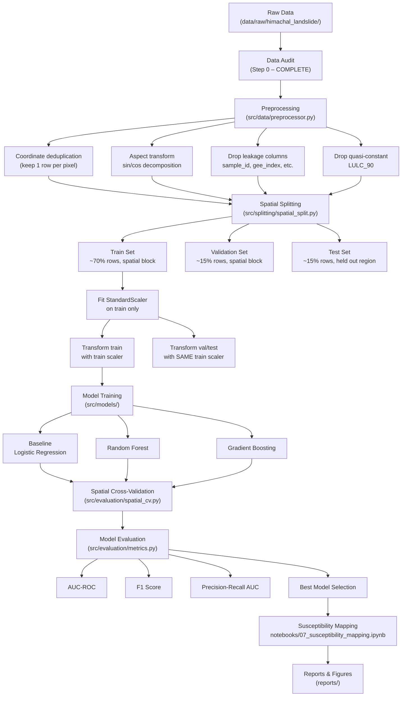

# RockWatch – Recommended Project Architecture

**Project:** RockWatch – Intelligent Landslide Susceptibility Prediction System  
**Technology Stack:** Python 3.14 · Pandas · NumPy · Scikit-learn · Matplotlib · Seaborn · Jupyter · Joblib  
**Study Area:** Himachal Pradesh, India  
**Last Updated:** 2026-11-16

---

## Recommended Folder Structure

```
RockWatch/
│
├── data/
│   ├── raw/
│   │   └── himachal_landslide/          # Original dataset – NEVER MODIFIED
│   │       ├── data_dictionary.csv
│   │       ├── figure_1_outlined.png
│   │       ├── hp_landslide_inventory_clean.csv
│   │       ├── inventory_records_without_features_36.csv
│   │       ├── landslide_features_master_6503.csv
│   │       ├── landslide_modelling_dataset_12409.csv
│   │       └── README.md
│   │
│   ├── processed/                       # Derived, cleaned, split datasets
│   │   ├── modelling_deduped.csv        # After coordinate deduplication
│   │   ├── train_spatial.csv            # Spatial training split
│   │   ├── val_spatial.csv              # Spatial validation split
│   │   ├── test_spatial.csv             # Held-out spatial test split
│   │   └── scaler_params.json           # StandardScaler means/stds from train only
│   │
│   └── external/                        # Any additional datasets (lithology, faults, etc.)
│
├── notebooks/
│   ├── 01_data_audit.ipynb              # Reproducible audit (mirrors reports/data_audit/)
│   ├── 02_preprocessing.ipynb           # Cleaning, aspect transform, spatial split
│   ├── 03_eda.ipynb                     # Exploratory data analysis and visualisations
│   ├── 04_baseline_models.ipynb         # Logistic Regression, Decision Tree baselines
│   ├── 05_advanced_models.ipynb         # Random Forest, Gradient Boosting, SVM
│   ├── 06_model_evaluation.ipynb        # Spatial CV, metrics, confusion matrices
│   ├── 07_susceptibility_mapping.ipynb  # Generate susceptibility raster / map
│   └── 08_model_interpretation.ipynb    # Feature importance, SHAP, partial dependence
│
├── src/
│   ├── __init__.py
│   │
│   ├── data/
│   │   ├── __init__.py
│   │   ├── loader.py                    # Functions to load raw and processed data
│   │   ├── validator.py                 # Data quality checks (schema, ranges, dtypes)
│   │   └── preprocessor.py             # Cleaning, aspect transform, encoding, scaling
│   │
│   ├── features/
│   │   ├── __init__.py
│   │   ├── engineer.py                  # Feature engineering (sin/cos aspect, log-dist)
│   │   └── selector.py                  # Feature selection utilities
│   │
│   ├── splitting/
│   │   ├── __init__.py
│   │   └── spatial_split.py            # Spatial blocking, GroupKFold by district/grid
│   │
│   ├── models/
│   │   ├── __init__.py
│   │   ├── baseline.py                  # Logistic Regression, Dummy classifier
│   │   ├── tree_models.py               # Random Forest, Gradient Boosting, XGBoost
│   │   └── svm_model.py                 # Support Vector Machine
│   │
│   ├── evaluation/
│   │   ├── __init__.py
│   │   ├── metrics.py                   # AUC-ROC, F1, precision-recall, MCC
│   │   ├── spatial_cv.py               # Spatial cross-validation runner
│   │   └── calibration.py              # Probability calibration checks
│   │
│   └── visualisation/
│       ├── __init__.py
│       ├── eda_plots.py                 # Histograms, box plots, correlation heatmaps
│       ├── spatial_plots.py            # Map plotting (susceptibility, train/test zones)
│       └── model_plots.py              # ROC curves, feature importance, SHAP plots
│
├── models/
│   ├── trained/                         # Serialised model files (joblib)
│   │   ├── logistic_regression_v1.joblib
│   │   ├── random_forest_v1.joblib
│   │   └── gradient_boosting_v1.joblib
│   │
│   └── evaluation/                      # Saved evaluation artefacts
│       ├── cv_results.csv
│       ├── test_metrics.json
│       └── confusion_matrices/
│
├── reports/
│   ├── data_audit/
│   │   ├── dataset_audit.md             # This audit report
│   │   └── project_architecture.md      # This architecture document
│   │
│   ├── figures/                         # All publication-ready plots
│   │   ├── class_distribution.png
│   │   ├── feature_distributions.png
│   │   ├── correlation_heatmap.png
│   │   ├── spatial_split_map.png
│   │   ├── roc_curves.png
│   │   └── susceptibility_map.png
│   │
│   └── final/
│       └── model_report.md              # Final modelling report
│
├── scripts/
│   ├── audit_step1.py                   # Data audit scripts (generated during audit)
│   ├── audit_step2.py
│   ├── audit_step3.py
│   └── audit_step4.py
│
├── tests/
│   ├── test_preprocessor.py
│   ├── test_spatial_split.py
│   └── test_metrics.py
│
├── .venv/                               # Virtual environment (Python 3.14)
├── requirements.txt                     # Pinned dependencies
└── README.md                            # Project overview and quickstart
```

---

## Pipeline Architecture



---

## Component Descriptions

### Phase 0 — Data Audit ✅ COMPLETE

| Task | Status | Output |
|------|--------|--------|
| Read all files | ✅ | Structural summaries in this audit |
| Identify target variable | ✅ | `class` (0/1) |
| Identify predictors | ✅ | 7 z-scored + 10 LULC one-hot |
| Missing value analysis | ✅ | Only structural NaNs (class-conditional) |
| Duplicate analysis | ✅ | 1,081 coordinate duplicates identified |
| Outlier analysis | ✅ | Dist_River and FlowAccumulation skewed |
| Leakage assessment | ✅ | Standardisation leakage confirmed |
| Spatial split strategy | ✅ | Latitude blocking recommended |
| Limitations documented | ✅ | 10+ limitations listed |

### Phase 1 — Preprocessing (Next Step)

| Task | Key Consideration |
|------|------------------|
| Coordinate deduplication | Identify max-count pixels; keep one row per unique (lat, lon) pair |
| Aspect circular transform | Compute `sin_aspect = sin(aspect_deg × π/180)`, `cos_aspect = cos(aspect_deg × π/180)` |
| Drop columns | Remove leakage/redundant columns listed in audit |
| Log-transform dist_river | Join raw `dist_river_m` from master features, apply log(1 + x) |
| Spatial split | Create three geographic folds (latitude bands or grid blocks) |
| Fit StandardScaler | Fit **only on training rows**; save scaler parameters to `data/processed/scaler_params.json` |
| Transform all sets | Apply train scaler to validation and test sets |
| Save processed datasets | Write to `data/processed/` with version suffix |

### Phase 2 — EDA

| Visualisation | Purpose |
|--------------|---------|
| Feature histograms by class | Understand separation power of each predictor |
| Correlation heatmap | Identify multicollinearity |
| Spatial scatter plot | Visualise train/val/test geographic splits |
| LULC class distribution by class | Identify LULC-susceptibility patterns |
| Elevation profile | Distribution of landslides by elevation band |

### Phase 3 — Baseline Models

| Model | Purpose |
|-------|---------|
| `DummyClassifier(strategy='most_frequent')` | Lower bound benchmark |
| `LogisticRegression` | Linear baseline; interpretable coefficients |
| `DecisionTreeClassifier(max_depth=5)` | Nonlinear baseline |

### Phase 4 — Advanced Models

| Model | Hyperparameters to Tune |
|-------|------------------------|
| `RandomForestClassifier` | n_estimators, max_depth, min_samples_leaf |
| `GradientBoostingClassifier` | n_estimators, learning_rate, max_depth |
| `SVC(probability=True)` | C, kernel, gamma |

### Phase 5 — Evaluation

**Primary metric:** AUC-ROC (threshold-independent)  
**Secondary metrics:** F1-score, Precision-Recall AUC, Matthews Correlation Coefficient  
**Evaluation framework:** Spatial GroupKFold cross-validation (groups = spatial blocks)  
**Test evaluation:** Final model evaluated once on the held-out spatial test region

### Phase 6 — Susceptibility Mapping

1. Apply trained model to a regular grid covering Himachal Pradesh.
2. Generate per-pixel susceptibility scores.
3. Classify into susceptibility classes (Low / Moderate / High / Very High).
4. Overlay with known landslide inventory for visual validation.
5. Export as georeferenced raster or GeoJSON.

---

## Key Design Decisions

| Decision | Rationale |
|----------|-----------|
| **Spatial split over random split** | Prevents spatial autocorrelation from inflating metrics; more realistic generalisation |
| **Re-standardise from training set** | Prevents preprocessing leakage from pre-computed z-scores |
| **Sin/cos aspect encoding** | Preserves circular nature of aspect angle |
| **Keep 10 LULC one-hots (minus LULC_90)** | Preserves land-cover information without redundancy |
| **Use master features file for extended modelling** | 40 features vs 7 provides far richer environmental context |
| **JobLib serialisation** | Standard, efficient model persistence for scikit-learn models |
| **Separate `src/` and `notebooks/`** | Keeps reusable logic modular; notebooks are for exploration and reporting |

---

## Dependency Requirements

```
pandas>=2.2
numpy>=2.0
scikit-learn>=1.5
matplotlib>=3.9
seaborn>=0.13
joblib>=1.4
jupyter>=1.1
notebook>=7.0
```

Managed by `.venv` (Python 3.14 virtual environment, already created).

---

> [!NOTE]
> This architecture document describes the **complete recommended system**. At the time of writing, only Phase 0 (Data Audit) is complete. No models have been trained. No frontend, backend, or deployment infrastructure has been created. Proceed phase-by-phase with explicit approval at each major milestone.

